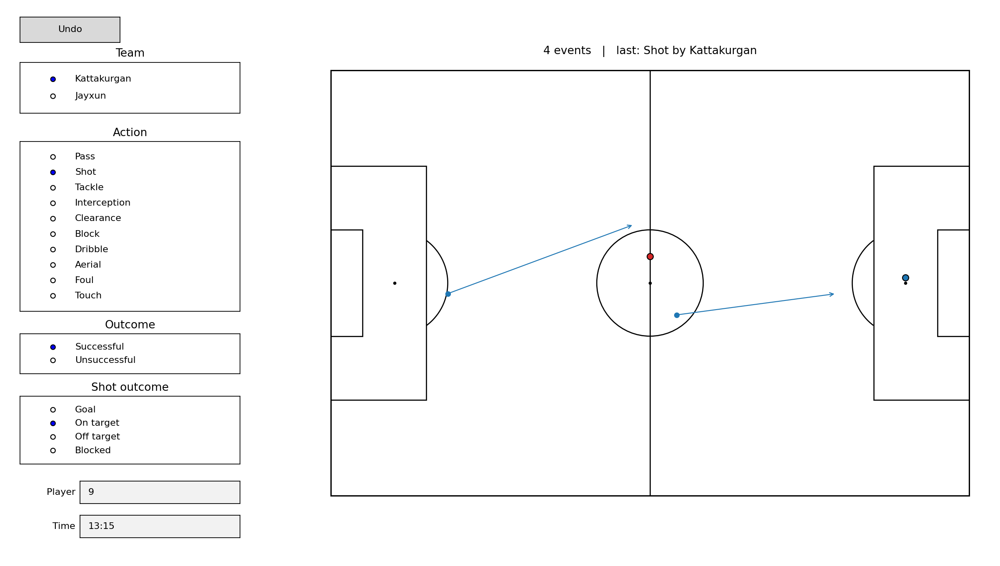

# Football Event Tagger

An interactive Python tool for manually logging football (soccer) match events from video footage. The tool provides a clickable pitch, team and action selectors, and immediate CSV export to support subsequent football analytics projects.

Developed initially for tagging **Kattakurgan vs. Jayxun** in Uzbekistan's Pro Liga, where detailed public event-level data can be difficult to obtain.




## Features

- **Interactive pitch:** Click to record the location of an event.
- **Ten event types:** Pass, Shot, Tackle, Interception, Clearance, Block, Dribble, Aerial, Foul, and Touch.
- **Pass coordinates:** Two clicks capture the start and end location, connected by an arrow.
- **Shot outcomes:** Goal, On target, Off target, or Blocked (only recorded for shots).
- **Event metadata:** Team, player number, match timestamp, and successful/unsuccessful outcome.
- **Immediate CSV saving:** Each completed event is written to `events.csv`.
- **Undo:** Remove the last logged event, or cancel a pass in progress.
- **Resume tagging:** Load previously saved event rows when the application starts again.

## Installation

Requires Python 3.9+ and a desktop environment capable of displaying a Matplotlib window.

```bash
# Clone your repository after publishing it on GitHub
git clone https://github.com/YOUR-USERNAME/football-event-tagger.git
cd football-event-tagger

# Optional: create a virtual environment
python -m venv .venv
source .venv/bin/activate  # Windows: .venv\Scripts\activate

pip install -r requirements.txt
python tagger.py
```

You can also download this repository and run the commands from its folder without cloning.

## How to use

1. Open a match recording in a separate window and pause at an event.
2. Choose a **Team**, **Action**, and **Outcome** on the left.
3. Enter the player's jersey number and match time (for example, `12:34`).
4. If the action is **Shot**, choose a **Shot outcome**.
5. Click the pitch where the event happened. For a **Pass**, click its start and then its destination.
6. Continue tagging; each completed event is automatically added to `events.csv` in the current working directory.
7. Click **Undo** to cancel an in-progress pass or delete the latest recorded event.

To tag another match, edit `TEAM_HOME`, `TEAM_AWAY`, and optionally `CSV_PATH` near the beginning of `tagger.py`.

## Output data

The script exports a CSV with these columns:

| Column | Meaning |
| --- | --- |
| `time` | User-entered match timestamp |
| `team` | Selected team name |
| `player` | User-entered player number |
| `action` | Event type |
| `x`, `y` | Starting/event location on the StatsBomb-style 120 × 80 pitch |
| `end_x`, `end_y` | Ending coordinates for passes; blank for other events |
| `outcome` | Successful or unsuccessful |
| `shot_outcome` | Goal, On target, Off target, Blocked for shots; blank otherwise |

### Notes and limitations

- Events are **manually tagged**, not inferred automatically from video.
- The video player is separate from this application; timestamps are entered by hand.
- The code does not currently calculate xG, heatmaps, or passing networks.
- Undo removes the latest saved row. On restart, previous rows are loaded, but **previously tagged markers are not redrawn on the pitch**.
- To avoid mixing matches, change the CSV filename before starting a new match.

## Technologies

- [Python](https://www.python.org/)
- [pandas](https://pandas.pydata.org/) for CSV storage
- [Matplotlib](https://matplotlib.org/) for widgets and interactive event markers
- [mplsoccer](https://mplsoccer.readthedocs.io/) for the pitch visualization

## Potential extensions

Player heatmaps, shot maps, passing networks, match momentum visualization, and xG modeling using collected event data.

## Status

Working prototype focused on manual event collection and CSV export.
